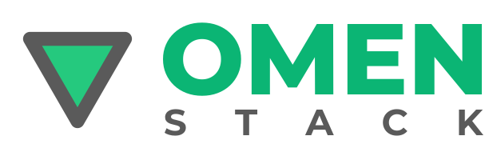
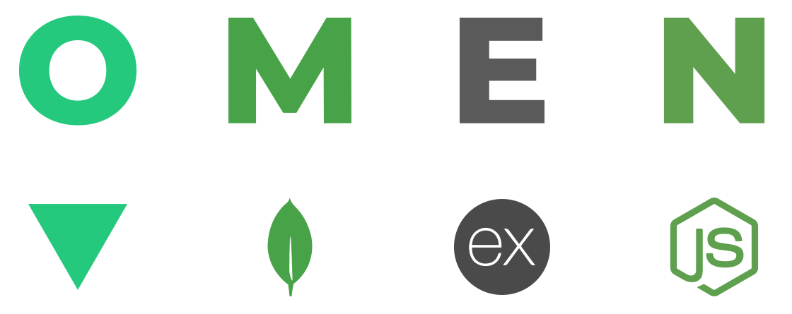

<p align="center">
  <picture>
    <source media="(prefers-color-scheme: dark)" srcset="assets/omen-logo-dark.svg">
    
  </picture>
</p>

<p align="center"><b>Full-stack JavaScript, simplified.</b></p>

<p align="center">
  <a href="https://olumjs.top">OlumJS</a> ·
  <a href="https://www.mongodb.com">MongoDB</a> ·
  <a href="https://expressjs.com">Express</a> ·
  <a href="https://nodejs.org">Node.js</a>
</p>

<p align="center">
  
</p>

# OMEN Stack

OMEN is a full-stack JavaScript stack built on four parts:

| Letter | Part | Job |
| :---: | --- | --- |
| **O** | [OlumJS](https://olumjs.top) | The front end. A small, fast VanillaJS framework for single-page apps. |
| **M** | [MongoDB](https://www.mongodb.com) | The database. Stores your data as JSON-like documents. |
| **E** | [Express](https://expressjs.com) | The web server. Handles routes, middleware, and the REST API. |
| **N** | [Node.js](https://nodejs.org) | The runtime. Runs JavaScript on the server. |

One language from the browser to the database. No heavy framework. No virtual DOM. Just HTML, CSS, and JavaScript.

## Why OMEN?

- **Plain JavaScript everywhere.** OlumJS is close to the platform, so what you know about the web still works.
- **Small and fast.** A light front end, a light server, and a flexible database.
- **Easy to learn.** If you know MEAN or MERN, you already know most of OMEN. Swap Angular or React for Olum.
- **JSON all the way.** Data moves from MongoDB, through Express, to Olum with no shape change.

## How it fits together

```
┌──────────────┐   HTTP / JSON   ┌──────────────────────┐   queries   ┌───────────┐
│    OlumJS    │ ──────────────▶ │  Express on Node.js  │ ──────────▶ │  MongoDB  │
│  (browser)   │ ◀────────────── │      (REST API)      │ ◀────────── │           │
└──────────────┘                 └──────────────────────┘             └───────────┘
```

## Requirements

- [Node.js](https://nodejs.org) 22.12 or newer
- [MongoDB](https://www.mongodb.com/try/download/community) running locally, or a [MongoDB Atlas](https://www.mongodb.com/atlas) URL

## Getting started

```bash
cp .env.example .env
npm install
npm install --prefix client
npm run dev
```

Open [http://localhost:3000](http://localhost:3000).

## Scripts

| Script | Job |
| --- | --- |
| `npm run dev` | Starts the client and the server with live reload. |
| `npm run build` | Builds the client, puts it inside the server, and builds the server. |
| `npm start` | Starts the built server. |

## Ports

You always open port 3000, in dev and in production.

**Dev (`npm run dev`)**

- **3000**: the proxy. Open this one. It shows the client and sends `/api` to the server.
- **3001**: the client (live reload). Used only inside your machine.
- **8000**: the server (API). Used only inside your machine.

**Production (`npm run build && npm start`)**

- **3000**: one server. Express serves the client and `/api` together.
- On Render, the port is the `PORT` that Render sets, not 3000. Your code uses it, so you do not need to do anything.

## Deploy (Render)

| Setting | Value |
| --- | --- |
| Build command | `npm install && npm run build` |
| Start command | `npm start` |
| Environment | `MONGO_URI` (for example, a MongoDB Atlas URL) |

Do not set `NODE_ENV=production` for the build. If you do, npm skips the dev packages that the build needs.

## Status

🚧 OMEN Stack is in early work. The starter template and CLI are coming soon. Watch this repo for updates.

## Learn more

- [OlumJS docs](https://olumjs.top/docs)
- [MongoDB docs](https://www.mongodb.com/docs)
- [Express docs](https://expressjs.com)
- [Node.js docs](https://nodejs.org/docs/latest/api/)

## Community

- [Discord](https://discord.gg/2zK7tb2Cg9)
- [Bluesky](https://bsky.app/profile/olumjs.bsky.social)

## License

MIT © Eissa Saber
